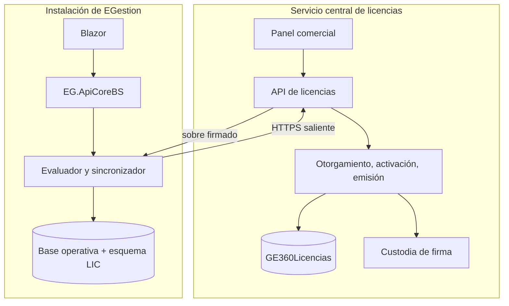

# Arquitectura de código propuesta

> **Estado actualizado:** esta arquitectura describe la opción futura con servicio central. La ruta vigente sin servicio central se encuentra en [ENFOQUE_SIMPLE_LICENCIA_FIRMADA.md](ENFOQUE_SIMPLE_LICENCIA_FIRMADA.md) y [PLAN_IMPLEMENTACION_SIMPLE.md](PLAN_IMPLEMENTACION_SIMPLE.md).

Este documento ubica el trabajo futuro sin modificar todavía la solución. Se apoya en la estructura actual de EGestion: API en `BackEnd/EG.ApiCoreBS`, lógica en `BackEnd/EG.Application`, contratos compartidos en `Shared/EG.Contracts` y Blazor en `FrontEnd/EG.Web`.

## Separación de responsabilidades

El servicio central y el sistema del cliente no comparten acceso SQL. La aplicación del cliente sólo abre una conexión HTTPS saliente hacia la API central; esto simplifica el despliegue bajo IIS y evita abrir la base de datos del cliente al exterior.

## Solución nueva para el servicio central

Crear una solución independiente, no un módulo dentro de la API operativa del cliente. Nombres propuestos, ajustables al nombre comercial final:

| Proyecto | Responsabilidad |
|---|---|
| `GE.Licensing.Api` | API HTTPS para panel, activación y sincronización |
| `GE.Licensing.Application` | Casos de uso: otorgar, renovar, suspender, activar, transferir y emitir autorización |
| `GE.Licensing.Domain` | Entidades, estados, reglas de vigencia y contratos internos |
| `GE.Licensing.Infrastructure` | SQL Server central, secuencia, criptografía, custodia y repositorios |
| `GE.Licensing.Contracts` | DTOs públicos de panel y protocolo de instalación; sin claves privadas |
| `GE.Licensing.Web` | Panel comercial para operadores autorizados |
| `GE.Licensing.Tests` | Reglas de fechas, idempotencia, firma, activación y comandos comerciales |

El panel se autentica con identidad separada de los usuarios de los clientes. Su permiso para otorgar o suspender se resuelve en la central, no en las tablas de roles de una instalación.

## Cambios propuestos dentro de EGestion

| Ubicación actual | Componentes nuevos | Responsabilidad |
|---|---|---|
| `BackEnd/EG.Domain` | `Platform/Licensing` | Interfaces `ILicenseEvaluator`, `ILicenseSnapshotStore`, modelos de estado y códigos de denegación |
| `BackEnd/EG.Application` | `Platform/Licensing` | Activación local, evaluación por capacidad, sincronización, reloj y actualización de estado |
| `BackEnd/EG.Infraestructure` | Modelos generados o configuración del esquema `LIC` | Persistir sobre firmado y estado local; seguir el mecanismo vigente de scripts/modelos generados |
| `BackEnd/EG.ApiCoreBS` | Controlador local de estado/activación, filtro o requisito comercial, hosted service | Exponer estado seguro al frontend y aplicar licencia en endpoints y procesos |
| `BackEnd/EG.ApiCoreBS/Auth` | `LicenseRequirement` y handler/filtro de capacidad | Componer licencia con la autorización existente, sin otorgar bypass comercial a SuperAdmin |
| `Shared/EG.Contracts` | DTOs de estado de licencia | Fecha, módulos visibles, mensajes y códigos seguros para Blazor |
| `FrontEnd/EG.Web/Services` | `LicenseStateService` y cliente local | Mantener revisión, vencimientos, avisos y notificación de cambio |
| `FrontEnd/EG.Web/Pages/Platform/Sistema` | Activación y estado de licencia | Pantallas de administrador del cliente |
| `FrontEnd/EG.Web/Layout` y `Pages/Platform/Home.razor` | Filtro de menú, búsqueda y tarjetas | Ocultar/etiquetar módulos sin confiar en ello como control de seguridad |
| `Tests/EG.UnidTest` | Pruebas de evaluador, autorización y rutas clave | Garantizar que una denegación no escribe datos |
| `Scripts` | Script versionado para esquema `LIC` local | Crear y actualizar estructuras de forma repetible |

No usar `BackEnd/EG.Common.Helper.ApplicationInstance` como fuente de licencia: es memoria de proceso y se pierde al reiniciar. Puede servir de forma limitada como notificación en memoria, pero el estado autorizado viene del sobre firmado local.

## Punto de control obligatorio en el backend

El orden de cada operación comercial será:

1. Autenticar al usuario.
2. Resolver la capacidad del endpoint, servicio o proceso.
3. Validar autorización comercial vigente para esa capacidad.
4. Validar permiso personal existente.
5. Resolver y validar alcance de empresa, sucursal, área y ejercicio.
6. Cargar recursos y ejecutar la operación.

Para recursos que sólo se conocen después de cargar datos —por ejemplo, una orden de compra o un documento— se aplicará un control imperativo después de identificar el recurso. El atributo `[Authorize]` actual sólo cubre identidad o policy antes de esa carga; no debe ser el único control para las capacidades de licencia.

Las operaciones que llaman servicios directamente, procedimientos SQL, reportes o procesos alojados deben inyectar `ILicenseEvaluator` de manera explícita. Un filtro HTTP no alcanza esas rutas.

## Integración con lo que ya existe

| Punto actual | Adaptación propuesta |
|---|---|
| `PermissionAuthorizationHandler` | Permanece para permisos personales. La licencia se evalúa aparte y siempre, incluso si el usuario es SuperAdmin. |
| `NavigateService.GetMenuAsync` | Filtrar la salida del procedimiento `SIS.spNodeMenu` y el fallback EF mediante `MenuCapacidad`; conservar padres que tengan hijos permitidos. |
| `MenuStateService` | Guardar también revisión de licencia y próxima transición de vigencia; invalidar cuando cambia cualquiera. |
| `AuthenticationProviderJWT` | No transportar derechos comerciales dentro del token de sesión. El estado de licencia se refresca sin renovar JWT. |
| `GenericReportProvider` y exportaciones | Resolver la capacidad específica del reporte antes de preparar o recuperar resultado. |
| `DocumentRagCleanupHostedService` e inicializadores | No dependen de venta de módulos, salvo que un proceso de negocio concreto tenga una capacidad asignada. La caída de la central no bloquea el arranque de IIS. |

## Protocolo mínimo entre instalación y central

| Mensaje | Origen | Contenido mínimo | Resultado |
|---|---|---|---|
| Activar | Instalación | Código, RequestId, clave pública nueva, versión | Instalación vinculada, derechos materializados y autorización firmada |
| Reto | Central | Nonce de vida corta | Prueba de posesión de clave por la instalación |
| Sincronizar | Instalación | Identidad, respuesta al reto, revisión actual, RequestId | Autorización nueva o confirmación de que sigue vigente |
| Cambio comercial | Panel | Revisión esperada, RequestId, actor y motivo | Evento auditable y revisión incrementada |

El navegador nunca habla con la API central directamente. El backend de EGestion protege los reintentos, valida sobre firmado, descarta respuestas de otra instalación y no registra códigos, claves ni sobres completos en los logs de usuario.

## Secuencia del primer incremento

1. Servicio central con Cliente, Instalación, Licencia, LicenciaModulo, Código de activación, IdentidadInstalacion, AutorizacionEmitida y EventoLicencia.
2. Esquema `LIC` local, almacén de autorización y evaluador local.
3. Activación y sincronización de una instalación de prueba.
4. Pantalla local de estado.
5. Una capacidad piloto `GRP.ALMA.SALIDA.SURTIR` protegida en menú, endpoint y servicio.
6. Suspensión, renovación y recuperación en una sesión abierta.
7. Revisión de la integración de póliza antes de habilitar el flujo completo de salidas en producción.

Con ese recorrido se valida la arquitectura completa antes de distribuir controles sobre todos los controladores actuales.
