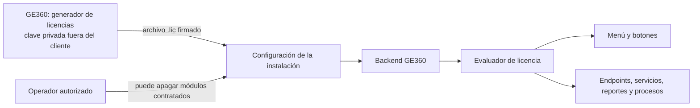

# Enfoque simple: licencia firmada por instalación

Fecha: 12 de septiembre de 2026. Estado: diseño elegido e integrado en el código; pendiente de validación en una instalación de pruebas con SQL Server e IIS.

## 1. Decisión

La instalación siempre se entrega completa. No se eliminan proyectos, pantallas, tablas ni procedimientos de los módulos no vendidos.

El contrato se materializa en un archivo de licencia firmado por GE360. El archivo indica qué módulos puede usar esa instalación y hasta cuándo. El configurador local sólo permite **reducir** ese conjunto: apagar una función contratada. No puede conceder módulos que no estén en el contrato.



No habrá API central, servidor de licencias ni sincronización periódica en esta primera versión. El único componente adicional será un generador de archivos `.lic` que se ejecuta sólo del lado de GE360; nunca se instala ni se envía al cliente.

## 2. Módulos comerciales

| Código | Módulo |
|---|---|
| `GRP.ADMIN` | Administración funcional |
| `GRP.ADQ` | Adquisiciones |
| `GRP.ALMA` | Almacén |
| `GRP.CONTA` | Contabilidad |
| `GRP.PATRI` | Patrimonio |
| `GRP.PRES` | Presupuesto |
| `NOM` | Nómina |
| `PBR` | PBR |

Acceso, autenticación, usuarios, permisos, la pantalla de licencia, respaldo técnico y recuperación siguen disponibles como núcleo del sistema. `GRP.ADMIN` comercial no debe confundirse con ese núcleo obligatorio.

## 3. Qué verá la persona que configura

En **Sistema > Licencia y módulos**, un usuario autorizado verá una sola lista. No capturará SQL, fechas ni claves criptográficas.

| Módulo | En contrato | Vigencia | Estado operativo | Acción disponible |
|---|---|---|---|---|
| Almacén | Sí | Hasta 12 dic. 2026 | Activo | Puede apagarlo |
| Adquisiciones | Sí | Hasta 12 dic. 2026 | Apagado | Puede encenderlo o dejarlo apagado |
| PBR | No | — | Bloqueado | Ninguna: sólo se muestra como no contratado |
| Nómina | Vencido | Terminó 31 ago. 2026 | Bloqueado | Ninguna: requiere nueva licencia |

Al importar una licencia:

1. El servidor comprueba la firma, el producto, la instalación destino, el número de serie, el formato y las fechas.
2. Los módulos no incluidos quedan apagados y bloqueados.
3. Los módulos incluidos pueden quedar activos por defecto o ser apagados por el configurador.
4. Todo cambio queda en auditoría con usuario, fecha y motivo.

Una casilla en pantalla, un valor en una tabla o un cambio de menú no son autoridad para activar un módulo. El backend vuelve a calcular el estado efectivo antes de ejecutar una operación.

## 4. Archivo de licencia y generación

El primer arranque crea una identidad y un secreto aleatorio de instalación protegidos por ASP.NET Core Data Protection. La pantalla muestra una solicitud con el identificador y la huella derivada de ese secreto. Ese dato se envía a GE360 junto con el contrato.

GE360 genera un archivo `.lic` firmado y ligado a esa instalación. El contenido firmado tendrá al menos:

```json
{
  "producto": "GE360",
  "versionFormato": 1,
  "idLicencia": "guid",
  "idInstalacion": "guid",
  "huellaClaveInstalacion": "sha256",
  "serial": 12,
  "emitidaUtc": "2026-09-12T18:00:00Z",
  "vigenteDesdeUtc": "2026-09-12T18:00:00Z",
  "modulos": [
    { "codigo": "GRP.ALMA", "inicioUtc": "2026-09-12T18:00:00Z", "finUtc": "2026-10-12T18:00:00Z" },
    { "codigo": "GRP.ADQ", "inicioUtc": "2026-09-12T18:00:00Z", "finUtc": "2026-10-12T18:00:00Z" }
  ],
  "keyId": "2026-01"
}
```

La licencia usará un sobre estándar firmado, por ejemplo JWS con `PS256` (RSA-PSS con SHA-256). El backend aceptará solamente el algoritmo, emisor y `keyId` definidos en el producto, y verificará con una clave pública integrada en el backend. La clave privada se conserva fuera del repositorio, de los paquetes de despliegue, de IIS, de `appsettings` y de la base de datos.

Una firma digital permite comprobar que el archivo no cambió desde que GE360 lo emitió. JWS está definido para proteger contenido mediante firmas, y en ASP.NET Core los requisitos de autorización se pueden combinar en una misma política o evaluador. [RFC 7515](https://www.rfc-editor.org/rfc/rfc7515.html) y la [documentación de autorización por políticas de ASP.NET Core](https://learn.microsoft.com/en-us/aspnet/core/security/authorization/policies?view=aspnetcore-10.0) respaldan esos dos mecanismos.

## 5. Regla única de uso

Para una capacidad del sistema, el backend aplicará esta regla:

```text
Puede usar = licencia firmada válida
          Y módulo incluido y dentro de su vigencia
          Y módulo activo en configuración local
          Y permiso del usuario
          Y alcance de los datos
```

La configuración local puede convertir el tercer resultado en falso; nunca puede convertir los dos primeros en verdadero. `SuperAdmin` conserva los permisos funcionales existentes, pero no salta los dos controles comerciales.

La comprobación se realiza en el servidor para:

- menús, buscador y tarjetas de inicio;
- endpoints y servicios de negocio;
- altas, cambios, autorizaciones, reportes y exportaciones;
- procesos alojados, integraciones y procedimientos llamados desde servicios.

El frontend sólo recibe el estado para presentarlo. Ocultar un menú mejora la experiencia, pero no constituye protección.

## 6. Vencimientos, pruebas y cambios de contrato

Una prueba o renta de N días se expresa mediante `InicioUtc` y `FinUtc` del módulo firmado. Al llegar a `FinUtc`, el evaluador niega las operaciones del módulo sin requerir que alguien reinicie IIS ni que se reinstale el sistema. Los datos permanecen en la base; la pantalla de licencia y las funciones de recuperación del núcleo continúan disponibles.

| Caso | Acción |
|---|---|
| Préstamo de Almacén por 30 días | Emitir `GRP.ALMA` con una fecha final 30 días después. |
| Pago o ampliación | Emitir un `.lic` nuevo con serial mayor y nueva fecha. El cliente lo importa. |
| Venta de un módulo adicional | Emitir un `.lic` nuevo que agregue el código contratado. |
| El cliente decide no usar un módulo contratado | El configurador lo apaga; no se requiere archivo nuevo. |
| El cliente vuelve a usar un módulo aún contratado | El configurador puede encenderlo. |
| Módulo no pagado | No se renueva. Al vencer, el backend lo bloquea. |

Para módulos que puedan retirarse por falta de pago no se emitirán licencias permanentes. La recomendación inicial es que todo contrato revocable tenga vigencia de 30, 60, 90 o 365 días y se renueve con un archivo firmado.

Sin una central, un archivo firmado anterior sigue siendo válido hasta su propia fecha final. Por eso el vencimiento corto o anual es la forma fiable de retirar uso sin depender de que el cliente importe un archivo nuevo. La suspensión inmediata y unilateral es una necesidad distinta: se deja para la alternativa centralizada.

## 7. Integraciones entre módulos

No se bloqueará todo un módulo por una integración que no se vendió. Cada cruce tendrá una capacidad propia y exigirá todos sus módulos:

| Capacidad de integración | Requiere |
|---|---|
| Requisición con disponibilidad o suficiencia | `GRP.ADQ` + `GRP.PRES` |
| Recepción de Almacén desde orden de compra | `GRP.ALMA` + `GRP.ADQ` |
| Salida de Almacén que genera póliza | `GRP.ALMA` + `GRP.CONTA` |
| Alta de Patrimonio desde orden de compra | `GRP.PATRI` + `GRP.ADQ` |
| Aplicación presupuestal de Nómina | `NOM` + `GRP.PRES` |
| Consulta de programas y presupuesto desde PBR | `PBR` + `GRP.PRES` |

Si falta uno, la pantalla explica qué integración no está contratada o está apagada. Las operaciones que no dependan de ese cruce continúan disponibles. La lista completa y su evidencia se mantiene en [MATRIZ_CAPACIDADES_INICIALES.md](MATRIZ_CAPACIDADES_INICIALES.md).

## 8. Protección frente a manipulación

Esta versión cubre el caso habitual de una persona que tiene acceso al navegador, al menú administrativo o a SQL Server y trata de activar un módulo editando un campo, importando JSON inventado o siguiendo instrucciones generadas por una IA:

- no tiene la clave privada que firma licencias;
- el backend rechaza cualquier firma, algoritmo, instalación, serial o fecha que no sea válida;
- un cambio en `ActivoOperativo` sólo puede apagar, nunca agregar un derecho comercial;
- la verificación se hace en API y lógica de negocio, no sólo en Blazor;
- se conserva auditoría de importaciones rechazadas y cambios locales;
- la fecha UTC más alta vista se protege con el almacén de datos protegido de Windows. Si el reloj retrocede de forma anormal, se bloquean escrituras de módulos hasta corregirlo o importar una licencia válida.

Una IA no puede fabricar una firma válida sin la clave privada. Sí puede explicar cómo modificar una tabla, pero esa modificación no pasa la validación del backend.

Hay un límite que debe quedar explícito: una persona con control total de Windows, IIS, SQL Server, los binarios y las copias de máquina puede reemplazar el validador, restaurar una máquina virtual o alterar el reloj con privilegios administrativos. Ningún esquema completamente local puede impedirlo de forma absoluta. Para revocar de inmediato ante ese nivel de control se necesitará después el servicio central de licencias; esta primera versión evita la manipulación ordinaria sin complicar el despliegue.

## 9. Reglas operativas de seguridad

1. El generador y la clave privada viven en un equipo o repositorio interno de GE360, con acceso limitado a quienes emiten contratos.
2. El cliente recibe sólo el `.lic` y la clave pública incluida en el backend; nunca el generador ni una contraseña compartida de firma.
3. La aplicación no debe conectarse a SQL Server con `sa`. Antes de liberar la función, se creará un usuario técnico de aplicación con los permisos mínimos necesarios.
4. La pantalla de importar y apagar/encender módulos exige un permiso administrativo específico y registra toda acción.
5. La licencia se valida al importar y al usar una capacidad; no se confía en un valor guardado en la sesión o en el JWT.
6. La sustitución o migración de servidor genera una nueva solicitud de instalación y una licencia nueva. No se reciclan huellas manualmente.

## 10. Resultado que se busca

El configurador conserva una operación sencilla: importa un archivo y puede apagar módulos. La capacidad de vender, prestar por N días, renovar o no renovar se conserva del lado de GE360. La barrera que protege el contrato es la firma del archivo y la validación en el backend, no una casilla editable en la base de datos.
