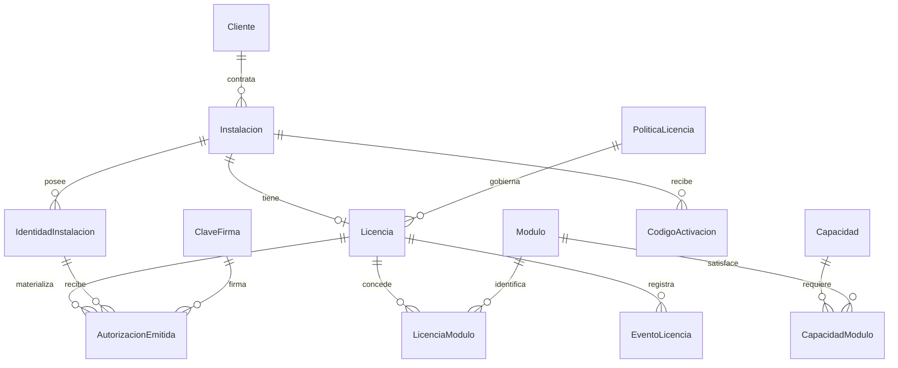

# Diccionario de datos propuesto: licenciamiento modular

> **Estado actualizado:** este modelo pertenece a la alternativa centralizada. Para la primera implementación usar [MODELO_DATOS_SIMPLE.md](MODELO_DATOS_SIMPLE.md).

Fecha: 12 de septiembre de 2026. Complementa [el plan de acción](PLAN_LICENCIAMIENTO_MODULAR.md). Diseño para SQL Server; no es un script ejecutado ni una descripción de tablas que ya existan.

## 1. Convenciones y límites

- Base central propuesta: `GE360Licencias`, esquema `LIC`. Base local: la base existente de cada instalación, también con esquema `LIC`. No hay FK entre bases ni acceso SQL remoto desde clientes a la central.
- PK internas: `bigint IDENTITY(1,1)`, salvo códigos de catálogo e identidad local única. Identidades públicas de instalación/licencia y autorizaciones: `uniqueidentifier`; no sirven como contraseña.
- Todos los tiempos de negocio: `datetime2(3)` UTC. Intervalos [InicioUtc, FinUtc). `FinUtc NULL` significa sin fin para una modalidad permanente o que un derecho PENDIENTE aún no fue materializado al activar; no significa acceso concedido ni licencia ausente.
- Fechas de auditoría: `CreadoUtc` y `ModificadoUtc`, con `SYSUTCDATETIME()` al crear. Los comandos centrales registran actor del proveedor de identidad comercial; nunca FK al usuario de una base cliente.
- Tablas mutables incluyen `RowVersion rowversion` para control de concurrencia. No es una fecha. Eventos y autorizaciones son registros anexados, no se editan para cambiar el pasado.
- Desactivar un catálogo no elimina derechos ya otorgados. Los derechos históricos deben poder interpretarse con la misma versión de catálogo. No usar cascadas de borrado en relaciones comerciales.
- Todas las columnas son NOT NULL salvo las marcadas `NULL`. Los catálogos de códigos indicados se implementan con CHECK o FK explícita; no texto libre arbitrario.

## 2. Tablas centrales: catálogo y clientes

### 2.1 LIC.Cliente

| Campo | Tipo | Regla |
|---|---|---|
| PkidCliente | bigint identity | PK |
| Codigo | varchar(40) | UNIQUE; identificador comercial |
| Nombre | nvarchar(200) | Nombre de cliente |
| Contacto | nvarchar(150) NULL | Contacto operativo |
| Correo | nvarchar(254) NULL | No implica autorización de envíos automáticos |
| Activo | bit | Baja de registro comercial, no suspende por sí misma licencias |
| CreadoUtc / ModificadoUtc | datetime2(3) | Auditoría |
| RowVersion | rowversion | Concurrencia |

Una fila representa a quien contrata. No duplicar aquí sus empresas, empleados ni operaciones. La facturación futura podrá referenciar este cliente.

### 2.2 LIC.Instalacion

| Campo | Tipo | Regla |
|---|---|---|
| PkidInstalacion | bigint identity | PK |
| InstalacionId | uniqueidentifier | UNIQUE; identidad pública persistente |
| FkidCliente | bigint | FK Cliente |
| Nombre | nvarchar(120) | Nombre reconocible |
| Entorno | varchar(12) | PRODUCCION, PRUEBAS |
| Estado | varchar(16) | PENDIENTE, ACTIVA, REVOCADA |
| ActivadaUtc | datetime2(3) NULL | Se fija en la primera activación; no se reinicia en una transferencia |
| UltimaConexionUtc | datetime2(3) NULL | Evidencia de contacto, no concesión de uso |
| UltimaRevisionConfirmada | bigint NULL | Revisión que el cliente reconoce haber aplicado |
| UltimaAutorizacionConfirmada | uniqueidentifier NULL | ID público correlacionable con AutorizacionEmitida |
| VersionAplicacion | varchar(40) NULL | Compatibilidad del cliente |
| CreadoUtc / ModificadoUtc | datetime2(3) | Auditoría |
| RowVersion | rowversion | Evita dos vinculaciones simultáneas |

PENDIENTE no tiene todavía una identidad vinculada y `ActivadaUtc` es NULL. ACTIVA requiere exactamente una identidad activa y `ActivadaUtc`. La identidad se recibe y vincula de forma atómica al consumir un código; si la instalación se pre-registra con una clave, esa modalidad debe usar un estado separado y no reutilizar PENDIENTE. No se ata exclusivamente a IP pública o nombre de máquina.

### 2.2.1 LIC.IdentidadInstalacion

| Campo | Tipo | Regla |
|---|---|---|
| PkidIdentidadInstalacion | bigint identity | PK |
| IdentidadInstalacionId | uniqueidentifier | UNIQUE; identificador público que se firma en autorizaciones |
| FkidInstalacion | bigint | FK Instalacion |
| ClavePublicaDispositivo | varbinary(1024) | SPKI de identidad de instalación |
| HuellaClaveDispositivo | binary(32) | SHA-256; UNIQUE global |
| Estado | varchar(16) | ACTIVA, REEMPLAZADA, REVOCADA |
| DesdeUtc | datetime2(3) | Inicio de validez |
| HastaUtc | datetime2(3) NULL | Se fija al reemplazar o revocar |
| Motivo | nvarchar(500) NULL | Obligatorio al reemplazar o revocar |
| FkidEventoLicencia | bigint NULL | FK EventoLicencia; se agrega después de crear la tabla de eventos |
| CreadoUtc | datetime2(3) | Auditoría |
| RowVersion | rowversion | Concurrencia |

UNIQUE filtrado para una sola identidad ACTIVA por instalación. Una transferencia inserta la identidad nueva y marca la anterior REEMPLAZADA o REVOCADA en la misma transacción que el evento y la nueva revisión. Las autorizaciones firmadas incluyen `IdentidadInstalacionId` y solo aceptan prueba de posesión de una identidad activa. La identidad previa conserva trazabilidad y puede operar como máximo hasta el límite offline de su última autorización, según la política de recuperación.

### 2.3 LIC.PoliticaLicencia

| Campo | Tipo | Regla |
|---|---|---|
| PkidPoliticaLicencia | bigint identity | PK |
| Codigo | varchar(40) | UNIQUE por versión: p. ej. ESTANDAR-V1 |
| SincronizarCadaMinutos | int | > 0; propuesta 15 |
| MaxSinConexionMinutos | int | >= SincronizarCadaMinutos; propuesta 4320 |
| GraciaComercialMinutos | int | >= 0; propuesta 0 |
| PermiteConsultaHistorica | bit | Propuesta 1 |
| PermiteExportacionHistorica | bit | Propuesta 1; implica consulta histórica |
| CreadoUtc | datetime2(3) | Versión inmutable una vez utilizada |

Cambiar la política crea una versión nueva y reasigna licencias expresamente, incrementando su revisión. No cambiar masivamente el contrato editando una fila usada. Los valores relevantes se copian a la autorización firmada; el cliente no consulta esta tabla directamente.

### 2.4 LIC.Modulo

| Campo | Tipo | Regla |
|---|---|---|
| CodigoModulo | varchar(32) | PK; ocho códigos del plan |
| Nombre | nvarchar(80) | Etiqueta comercial |
| Grupo | varchar(16) | GRP o INDEPENDIENTE |
| Orden | smallint | Presentación |
| DisponibleVenta | bit | Desactivar no revoca contratos existentes |
| CreadoUtc | datetime2(3) | Auditoría |

No insertar CORE como producto vendible. Cambiar el nombre no modifica su código ni sus permisos. No tratar GRP como requisito adicional de sus hijos.

### 2.5 LIC.Capacidad

| Campo | Tipo | Regla |
|---|---|---|
| CodigoCapacidad | varchar(100) | PK; estable entre despliegues |
| Nombre | nvarchar(160) | Operación reconocible |
| Tipo | varchar(20) | NUCLEO, CONSULTA, MUTACION, INTEGRACION |
| PermiteHistorico | bit | Solo CONSULTA o núcleo explícitamente revisado |
| VersionDefinicion | int | > 0 |
| ActivaCatalogo | bit | Control de nuevas asignaciones; no cambia firmas emitidas |
| CreadoUtc | datetime2(3) | Auditoría |

No ampliar en sitio el significado de una capacidad otorgada. Un cambio incompatible usa otro código. Ejemplos de propuesta: `CORE.LICENCIA.CONSULTAR`, `GRP.ALMA.SALIDA.SURTIR`, `NOM.CALCULAR`, `NOM.PRESUPUESTO.GENERAR`.

### 2.6 LIC.CapacidadModulo

| Campo | Tipo | Regla |
|---|---|---|
| CodigoCapacidad | varchar(100) | FK Capacidad; parte de PK |
| CodigoModulo | varchar(32) | FK Modulo; parte de PK |

Todos los módulos de una capacidad son obligatorios (AND). Ejemplo: `NOM.PRESUPUESTO.GENERAR` requiere NOM y GRP.PRES. Si existen dos modalidades alternativas, crear dos capacidades distintas; no interpretar ambiguamente varias filas como OR.

Una capacidad sin requisitos solo puede ser NUCLEO; el publicador de catálogo valida esta regla y exige requisitos para las demás. El núcleo tiene una lista explícita; un olvido de asociación no vuelve libre un endpoint. Las operaciones de núcleo no se activan simplemente porque alguien cambie esta tabla: también deben estar reconocidas por el manifiesto del código publicado.

## 3. Tablas centrales: derechos

### 3.1 LIC.Licencia

| Campo | Tipo | Regla |
|---|---|---|
| PkidLicencia | bigint identity | PK |
| LicenciaId | uniqueidentifier | UNIQUE público |
| FkidInstalacion | bigint | FK Instalacion, UNIQUE; una licencia para el producto por instalación |
| FkidPoliticaLicencia | bigint | FK PoliticaLicencia |
| EstadoAdministrativo | varchar(16) | ACTIVA, SUSPENDIDA, REVOCADA |
| Revision | bigint | >= 1, creciente ante cada cambio comercial |
| MotivoEstado | nvarchar(500) NULL | Obligatorio al suspender/revocar |
| CreadoUtc / ModificadoUtc | datetime2(3) | Auditoría |
| RowVersion | rowversion | Concurrencia |

No tiene una única fecha comercial de vencimiento: cada módulo vence por separado. Suspensión global prevalece sobre los derechos individuales. Reactivar la licencia no cambia sus fechas; REVOCADA es terminal y exige recuperación administrativa explícita, no renovación ordinaria.

### 3.2 LIC.LicenciaModulo

| Campo | Tipo | Regla |
|---|---|---|
| PkidLicenciaModulo | bigint identity | PK |
| FkidLicencia | bigint | FK Licencia |
| CodigoModulo | varchar(32) | FK Modulo |
| Modalidad | varchar(16) | PRUEBA, SUSCRIPCION, PERMANENTE |
| EstadoAdministrativo | varchar(16) | PENDIENTE, HABILITADO, SUSPENDIDO, REVOCADO |
| IniciaAlActivar | bit | Solo para derechos iniciales pendientes de primera activación |
| DiasConcedidos | int NULL | > 0 cuando se fija duración por N días; sirve para materializar las fechas |
| InicioUtc | datetime2(3) NULL | NULL únicamente mientras PENDIENTE |
| FinUtc | datetime2(3) NULL | Fin comercial nominal exclusivo; obligatorio para PRUEBA/SUSCRIPCION no pendientes |
| OperarHastaUtc | datetime2(3) NULL | Límite exclusivo para operaciones ordinarias, incluida gracia aprobada; nunca menor que FinUtc |
| PrimeraPruebaInicioUtc | datetime2(3) NULL | No se borra al renovar o convertir; impide reiniciar prueba accidentalmente |
| MotivoEstado | nvarchar(500) NULL | Obligatorio al suspender/revocar |
| CreadoUtc / ModificadoUtc | datetime2(3) | Auditoría |
| RowVersion | rowversion | Concurrencia |

UNIQUE(FkidLicencia, CodigoModulo). Mantener una fila actual; el historial completo reside en EventoLicencia con antes/después. No borrar y reinsertar para renovar. No hace falta columna Pagado: el derecho aprobado y su fecha son la decisión comercial; el comprobante se referencia en el evento.

Checks: `FinUtc > InicioUtc` cuando ambas existan; `OperarHastaUtc >= FinUtc`; PERMANENTE exige `InicioUtc IS NOT NULL`, `FinUtc = NULL` y `OperarHastaUtc = NULL`; un derecho no permanente ya concedido exige las tres fechas. PENDIENTE no concede acceso, aunque tenga DiasConcedidos. Al activar se fijan fechas una vez. Agregar una prueba después de activar comienza con la concesión central y no espera otra activación de la instalación.

VENCIDO, NO_INICIADO y EN_GRACIA son estados efectivos calculados por fecha, no estados persistidos que dependan de que una tarea nocturna se ejecute. Un módulo no contratado no tiene fila. Una segunda prueba exige comando explícito de extensión/reactivación con motivo; la interfaz no debe otorgarla de nuevo por una reinstalación.

### 3.3 LIC.CodigoActivacion

| Campo | Tipo | Regla |
|---|---|---|
| PkidCodigoActivacion | bigint identity | PK |
| FkidInstalacion | bigint | FK Instalacion |
| CodigoHash | binary(32) | UNIQUE; SHA-256 de código aleatorio de 32 bytes |
| CreadoUtc | datetime2(3) | Emisión |
| ExpiraUtc | datetime2(3) | > CreadoUtc |
| ConsumidoUtc | datetime2(3) NULL | Solo una vez |
| RevocadoUtc | datetime2(3) NULL | Permite cancelar un código no usado |
| SolicitudActivacionId | uniqueidentifier NULL | Índice UNIQUE filtrado; idempotencia |
| HuellaClaveConsumidora | binary(32) NULL | Permite comparar el reintento con la identidad que activó |
| FkidIdentidadInstalacion | bigint NULL | FK IdentidadInstalacion creada al consumir el código |
| FkidAutorizacionEmitida | bigint NULL | FK AutorizacionEmitida; resultado de activación idempotente |
| RowVersion | rowversion | Concurrencia |

Consumo atómico condicionado a no consumido, no revocado y vigente, junto con creación de IdentidadInstalacion, materialización de pruebas y evento. Limitar intentos; nunca registrar código en URL, logs o historial. Reintentar con la misma solicitud e identidad devuelve el resultado ligado por FK, no otra concesión. Antes de devolverlo, validar que la autorización pertenece a la licencia de la instalación del código y a la identidad consumidora. Si la firma falla después del commit, finalizar la emisión en un reintento usando las fechas ya persistidas.

## 4. Tablas centrales: firma y auditoría

### 4.1 LIC.ClaveFirma

| Campo | Tipo | Regla |
|---|---|---|
| Kid | varchar(80) | PK; identificador público |
| Algoritmo | varchar(12) | Lista permitida; inicialmente ES256 |
| ClavePublicaJwk | nvarchar(max) | JSON válido; solo componentes públicos |
| ReferenciaCustodia | nvarchar(400) | Ubicación lógica de clave en custodia; no secreto ni material privado |
| DesdeUtc | datetime2(3) | Inicio de emisión |
| EmitirHastaUtc | datetime2(3) NULL | Fin de nuevas emisiones |
| VerificarHastaUtc | datetime2(3) NULL | Solapamiento para autorizaciones emitidas |
| Estado | varchar(16) | ACTIVA, RETIRADA, COMPROMETIDA |
| CreadoUtc | datetime2(3) | Auditoría |

Firmar solo con ACTIVA y en ventana de emisión. No confiar en esta tabla mutable del cliente; esta existe únicamente en central. La distribución de claves públicas se ancla en confianza del producto y canal autenticado. Una clave comprometida requiere política de revocación y actualización de confianza; el efecto offline sigue limitado por conectividad.

### 4.2 LIC.AutorizacionEmitida

| Campo | Tipo | Regla |
|---|---|---|
| PkidAutorizacionEmitida | bigint identity | PK interno |
| AutorizacionId | uniqueidentifier | UNIQUE; jti |
| FkidLicencia | bigint | FK Licencia |
| FkidIdentidadInstalacion | bigint | FK IdentidadInstalacion |
| Kid | varchar(80) | FK ClaveFirma |
| SerialEmision | bigint | UNIQUE global, generado por `LIC.SeqAutorizacionEmision` y firmado |
| RevisionLicencia | bigint | Revisión comercial del snapshot |
| EmitidaUtc | datetime2(3) | Hora central |
| OperacionOfflineHastaUtc | datetime2(3) | Límite de autorización técnica, no prórroga comercial |
| FormatoVersion | int | > 0 |
| CatalogoVersion | varchar(40) | Versión compatible de capacidades |
| SobreFirmado | nvarchar(max) | JWS compacto o formato firmado definido |
| HashSobre | binary(32) | Huella de bytes del sobre |
| SolicitudId | uniqueidentifier | UNIQUE; emisión idempotente |

El sobre incluye identidad de instalación, identidad criptográfica, licencia, entorno, emisor, audiencia, serial global, revisión, fechas, estado global y derechos por módulo/capacidad, incluida la política histórica. El snapshot se toma de una sola revisión consistente. `SerialEmision` ordena sobres técnicos incluso cuando comparten revisión o cambia `kid`; la instalación solo acepta la misma revisión si el serial es mayor. La emisión inicial y su relación con el código se finalizan idempotentemente. La ausencia de conectividad no produce una nueva autorización local.

Firmar capacidades con requisitos y ventanas calculadas. Para una integración, la ventana efectiva no puede exceder la de ninguno de sus módulos requeridos. El token de licencia es distinto del JWT de sesión de usuarios y no se acepta como credencial de usuario.

### 4.3 LIC.EventoLicencia

| Campo | Tipo | Regla |
|---|---|---|
| PkidEventoLicencia | bigint identity | PK |
| FkidLicencia | bigint | FK Licencia |
| CodigoModulo | varchar(32) NULL | FK Modulo; NULL si evento global o afecta varios |
| Tipo | varchar(30) | ALTA, CONCESION, ACTIVACION, RENOVACION, SUSPENSION, REACTIVACION, REVOCACION, TRANSFERENCIA, POLITICA, EXTENSION_PRUEBA |
| FechaUtc | datetime2(3) | Hora central |
| ActorId | nvarchar(200) | Sujeto del proveedor de identidad comercial o identidad de servicio |
| Motivo | nvarchar(500) | Obligatorio |
| ReferenciaComercial | nvarchar(150) NULL | Folio de pago/acuerdo manual; no implica verificación automática |
| RevisionAnterior / RevisionNueva | bigint | Cambio monotónico |
| AntesJson / DespuesJson | nvarchar(max) | JSON válido, snapshot de campos afectados; sin secretos |
| RequestId | uniqueidentifier | UNIQUE global: un comando comercial, un evento |
| HashSolicitud | binary(32) | Reintento con mismo ID y distinto contenido devuelve conflicto |

Evento y actualización de derechos se escriben en la misma transacción. Un comando que concede varios módulos usa un solo evento con arrays y CodigoModulo NULL. Los reintentos devuelven el resultado persistido; nunca vuelven a sumar días. Las renovaciones se expresan como Inicio/Fin/OperarHasta objetivos aprobados por el operador.

La tabla es append-only para las cuentas de aplicación. No se le aplica baja lógica. No registrar un evento por cada consulta HTTP: el historial comercial no sustituye la telemetría técnica.

## 5. Relaciones e índices centrales

Índices además de PK/UNIQUE: Instalacion(FkidCliente); LicenciaModulo(EstadoAdministrativo, FinUtc) INCLUDE(FkidLicencia, CodigoModulo); AutorizacionEmitida(FkidLicencia, EmitidaUtc DESC); EventoLicencia(FkidLicencia, FechaUtc DESC); CodigoActivacion(FkidInstalacion, CreadoUtc DESC). Medir tamaño y planes antes de agregar más índices.

La emisión lee derechos y revisión de forma consistente; si otra transacción suspende, la siguiente sincronización entregará una revisión superior. No afirmar que una autorización previamente emitida desaparece de una instalación desconectada.

## 6. Tablas locales de cada instalación

### 6.1 LIC.EstadoInstalacion

| Campo | Tipo | Regla |
|---|---|---|
| PkidEstadoInstalacion | tinyint | PK, CHECK = 1; singleton |
| InstalacionId | uniqueidentifier NULL | Identidad confirmada al activar |
| LicenciaId | uniqueidentifier NULL | Referencia pública central, sin FK entre bases |
| IdentidadInstalacionId | uniqueidentifier NULL | Identidad criptográfica vigente confirmada |
| FkidAutorizacionRecibida | bigint NULL | FK AutorizacionRecibida; snapshot actual |
| RevisionMaximaAceptada | bigint | >= 0 |
| SerialMaximoAceptado | bigint | >= 0; orden técnico de sobres |
| UltimaHoraCentralUtc | datetime2(3) NULL | Referencia contra rollback de reloj |
| UltimaSincronizacionUtc | datetime2(3) NULL | Evidencia de aceptación exitosa |
| UltimoIntentoUtc | datetime2(3) NULL | Diagnóstico |
| UltimoCodigoError | varchar(60) NULL | Sin secretos ni stacktrace para usuario |
| ReferenciaClaveLocal | nvarchar(200) NULL | Referencia a clave privada protegida fuera de BD |
| RowVersion | rowversion | Sustitución atómica |

Estos campos aceleran y describen el estado; no conceden uso. El backend verifica siempre la integridad del snapshot y valida consistencia de sus metadatos. Reiniciar/reinstalar o editar fechas de esta tabla no debe crear derechos.

### 6.2 LIC.AutorizacionRecibida

| Campo | Tipo | Regla |
|---|---|---|
| PkidAutorizacionRecibida | bigint identity | PK |
| AutorizacionId | uniqueidentifier | UNIQUE; jti central |
| InstalacionId | uniqueidentifier | Debe coincidir con identidad vinculada |
| IdentidadInstalacionId | uniqueidentifier | Debe coincidir con la identidad criptográfica vigente |
| RevisionLicencia / SerialEmision | bigint | Orden comercial y técnico |
| Kid | varchar(80) | No FK local; debe existir en la confianza pública del producto |
| EmitidaUtc | datetime2(3) | Del sobre firmado |
| OperacionOfflineHastaUtc | datetime2(3) | Del sobre firmado |
| RecibidaUtc | datetime2(3) | Hora local de recepción, no fuente comercial |
| SobreFirmado | nvarchar(max) | Copia íntegra |
| HashSobre | binary(32) | Coherencia de almacenamiento |

Insertar solo tras validar. Los metadatos duplicados se comprueban contra el sobre; no confiar en un `EsValida bit` persistido. Conservar el actual y las evidencias necesarias según retención técnica; no usar firmas más antiguas para revertir una suspensión recibida. No hay tabla editable local `ModulosHabilitados` que permita concesiones.

### 6.3 LIC.MenuCapacidad

| Campo | Tipo | Regla |
|---|---|---|
| FkidMenuSis | int | FK al PK real de SIS.Menu (`PkidMenu` en modelo C#); parte de PK |
| CodigoCapacidad | varchar(100) | Parte de PK; verificado contra manifiesto del producto |

Un menú aparece si tiene alguna capacidad accesible (OR) y el permiso de navegación del usuario. Esto solo decide presentación; no combina requisitos operativos. Los agrupadores se muestran si tienen hijos visibles. La política histórica puede mantener un acceso de consulta sin mostrar acciones de modificación.

El menú y sus permisos existentes se conservan. No cambiar `Menu.Activo` para simular contratación. No hay FK a la base central. Los scripts de despliegue y la validación de manifiesto aseguran que los códigos existan.

### 6.4 LIC.RecursoCapacidad

| Campo | Tipo | Regla |
|---|---|---|
| TipoRecurso | varchar(20) | PANTALLA, REPORTE, EXPORTACION, ENDPOINT, SERVICIO o PROCESO; parte de PK |
| ClaveRecurso | varchar(150) | Identificador estable; parte de PK |
| CodigoCapacidad | varchar(100) | Parte de PK; verificado contra manifiesto |

En un recurso compuesto se exigen todas sus capacidades (AND). Si debe ofrecer alternativas, definir recursos/modalidades separados. Las filas apoyan migración de rutas, reportes, endpoints, servicios internos y procesos; el backend debe contrastarlas con un manifiesto de requisitos incluido en el código. Borrar una fila no vuelve libre el recurso: recurso sin clasificación se rechaza y se diagnostica. Los endpoints y servicios tienen además controles explícitos, no solo esta tabla editable.

### 6.5 LIC.EventoLocal

| Campo | Tipo | Regla |
|---|---|---|
| PkidEventoLocal | bigint identity | PK |
| FechaUtc | datetime2(3) | Hora observada local |
| Tipo | varchar(40) | ACTIVACION, SINCRONIZACION, FIRMA_INVALIDA, CAMBIO_ESTADO, RELOJ_INCONSISTENTE, TRANSFERENCIA |
| AutorizacionId | uniqueidentifier NULL | Correlación |
| RevisionLicencia | bigint NULL | Diagnóstico |
| CodigoResultado | varchar(60) | Resultado estable |
| Detalle | nvarchar(1000) NULL | Información reducida, sin códigos, claves ni sobre completo |

Índice por FechaUtc; retención inicial propuesta 90 días ajustable por volumen. Las denegaciones funcionales pueden utilizar la auditoría existente para evitar duplicación masiva. No mostrar detalles criptográficos a usuarios comunes.

## 7. Decisión de acceso: sin estados ambiguos

Para una operación ordinaria:

1. Identidad y permisos de usuario válidos para el recurso y alcance.
2. Sobre de firma válida, instalación y entorno correctos, revisión aceptable.
3. Autorización técnica aún vigente; si exige sincronización, no conceder escritura.
4. Licencia global ACTIVA y todos los módulos requeridos HABILITADOS.
5. Ahora está dentro de [InicioUtc, OperarHastaUtc) de cada derecho temporal; `FinUtc` es el vencimiento comercial nominal y `OperarHastaUtc` incorpora una gracia expresa. Un permanente no tiene límite comercial.
6. Capacidad incluida en el sobre y requisitos compatibles con el manifiesto instalado.

VENCIDO se deriva de la fecha; SUSPENDIDO y REVOCADO son decisiones explícitas que prevalecen. Una integración usa el límite más temprano de sus requisitos. La consulta histórica después de vencimiento/suspensión es una ruta de evaluación distinta, explícitamente permitida por política firmada y manifiesto, sin efectos laterales ni bypass de permisos.

Para prueba de 15 días activada en T0: InicioUtc=T0, FinUtc=T0+15 días, OperarHastaUtc=FinUtc con gracia cero. Una autorización emitida poco antes no permite operar después de FinUtc. Renovar transforma modalidad/fechas según el acuerdo; no borra PrimeraPruebaInicioUtc ni los eventos previos.

## 8. Extensiones posteriores, no necesarias para la primera entrega

- `LIC.Paquete` y `LIC.PaqueteModulo`: composición versionada de ofertas. Al vender se materializa la selección en LicenciaModulo; cambiar un paquete no modifica contratos ya concedidos.
- `COM.Pago`: proveedor, referencia única, estado confirmado, fechas, moneda e importe según contrato.
- `COM.PagoAplicacion`: relación de pago a licencia/módulo/periodo, con restricción de aplicación única y evento comercial correlacionado.
- `COM.EventoProveedor`: UNIQUE(proveedor, EventId), recepción, verificación de firma, estado de procesamiento y resultado. Verificar servidor a servidor y procesar transaccionalmente; no conceder acceso por redirección de navegador.

Estas tablas se diseñarán con el proveedor seleccionado; no se proponen importes, moneda ni política de reembolso ahora. La primera versión usa comandos comerciales manuales con referencia e idempotencia.

## 9. Secuencia de construcción SQL y aplicación

1. Crear tablas centrales de catálogo, cliente, instalación e identidad; después derechos, códigos y firma/auditoría. Agregar las FK de evento en IdentidadInstalacion y de autorización en CodigoActivacion solo después de crear sus tablas destino.
2. Crear AutorizacionRecibida local antes de EstadoInstalacion y sus tablas de mapeo/eventos.
3. Sembrar los ocho códigos y el manifiesto aprobado de capacidades; no asignar números de menú a ciegas, resolver contra la base objetivo y fallar ante ambigüedad.
4. Preparar scripts repetibles con verificación de estructura, transacciones cuando correspondan, comprobaciones antes/después y respaldo. No ejecutar en producción durante el diseño.
5. Generar únicamente modelos y contratos necesarios; mantener separadas las conexiones de servicio central y aplicación cliente.
6. Probar unicidad, FK, nulos condicionales, fechas, consumo concurrente del código y actualización de revisión con evento en una misma transacción.

Pendiente de validación física: no se consultó el esquema vivo de SQL Server. El nombre SQL exacto y tipo de la PK de SIS.Menu se confirmarán contra metadatos antes de escribir su FK. El plan se basa en los modelos y scripts del repositorio.
