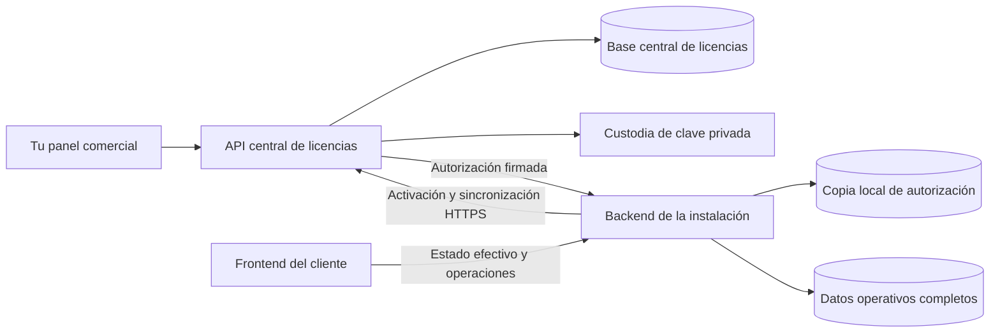

# Plan de acción: licenciamiento modular por instalación

> **Estado actualizado:** esta es la alternativa avanzada con servicio central y revocación remota. La primera implementación elegida es la [licencia firmada local](ENFOQUE_SIMPLE_LICENCIA_FIRMADA.md); no iniciar este diseño central todavía.

Fecha: 12 de septiembre de 2026. Estado: propuesta técnica para revisión; no implementada.

## 1. Resultado esperado y alcance

Instalar siempre la aplicación completa. Vender o prestar el uso de módulos mediante una licencia por instalación, administrada desde un servicio central propio. Agregar, renovar, suspender o reactivar derechos sin reinstalar y sin eliminar datos del cliente.

Alcance confirmado: por instalación, no por empresa ni por usuario. Una instalación puede operar varias empresas; sus derechos comerciales son comunes, pero cada usuario conserva sus permisos y restricciones de datos. El cliente comercial del servicio central no es una fila de `SIS.Empresa` del sistema instalado.

La primera entrega incluye pruebas por N días, suscripciones, licencias permanentes, activación, control de vigencias, suspensión remota, consulta histórica y registro manual de renovaciones. Cobros automáticos, facturación, precios e impuestos quedan para una segunda etapa. Este diseño no incluye ejecutar cambios en SQL Server ni desplegar un nuevo servicio todavía.

## 2. Productos y capacidades

| Código estable | Módulo vendible | Agrupador |
|---|---|---|
| GRP.ADMIN | Administración funcional | GRP |
| GRP.ADQ | Adquisiciones | GRP |
| GRP.ALMA | Almacén | GRP |
| GRP.CONTA | Contabilidad | GRP |
| GRP.PATRI | Patrimonio | GRP |
| GRP.PRES | Presupuesto | GRP |
| NOM | Nómina | Independiente |
| PBR | PBR | Independiente |

GRP y Sistema completo serán selecciones de varios módulos. No habrá un noveno derecho independiente llamado GRP que contradiga el estado de sus hijos. En la primera versión pueden ser selecciones del panel; las tablas de paquetes se incorporan cuando sea necesario versionar ofertas comerciales.

Antes de programar se debe delimitar Administración funcional. Identidad, usuarios, permisos, activación, configuración de licencia y recuperación quedan en un núcleo obligatorio, fuera del módulo comercial. También permanecen los servicios organizacionales y catálogos mínimos que se declaren compartidos.

Una **capacidad** identifica una operación concreta, por ejemplo `GRP.ALMA.SALIDA.SURTIR`, `NOM.CALCULAR` o `NOM.PRESUPUESTO.GENERAR`. Se asocia a acciones y recursos, no al texto del menú ni al prefijo de una URL. Una capacidad de integración puede exigir más de un módulo; todos sus requisitos deben cumplirse.

Regla efectiva: identidad válida + capacidad comercial vigente + permiso de acción + alcance de los datos. `SuperAdmin` podrá tener privilegios funcionales, pero no saltarse la comprobación comercial. El núcleo obligatorio sigue requiriendo los permisos correspondientes.

## 3. Arquitectura

El backend del cliente consulta la API central. El navegador no recibe códigos secretos, claves de instalación ni la autorización firmada completa. Recibe únicamente el estado efectivo necesario para mostrar módulos, restricciones y vencimientos.

La base central es la autoridad sobre derechos. La base local conserva una autorización firmada que el backend verifica con claves públicas confiables. No se podrá habilitar una función cambiando un `Activo` local. La aplicación completa continúa instalada; deshabilitar uso no quita tablas, procedimientos ni archivos.

La firma protege la integridad de la autorización. No promete resistencia absoluta a un administrador que controle el servidor, modifique binarios o restaure toda la máquina. Evitar totalmente esos cambios requeriría trasladar operaciones al servicio alojado por nosotros; queda fuera de este alcance.

## 4. Reglas propuestas de vigencia

Los siguientes valores son una base de diseño, pendientes de decisión comercial final:

| Regla | Propuesta inicial |
|---|---|
| Inicio de prueba | Al activar la instalación; para módulo añadido posteriormente, al habilitarlo desde el panel |
| Duración N días | N periodos de 24 horas desde el inicio UTC confirmado por el servidor central |
| Fin de vigencia | `FinUtc` es el vencimiento comercial nominal; una operación ordinaria se permite hasta `OperarHastaUtc` |
| Avisos | 7, 3 y 1 días antes, mostrando los que correspondan a la duración |
| Sincronización | Cada 15 minutos, al arrancar y a petición del administrador; solicitudes salientes |
| Tolerancia sin conexión | Hasta 72 horas desde la última autorización aceptada, limitada además por la vigencia del módulo |
| Gracia comercial | 0 horas por defecto; una extensión expresa y registrada puede concederla |
| Al terminar la vigencia operativa | Al llegar a `OperarHastaUtc`, permitir solo consulta histórica/exportación autorizadas y bloquear altas, cambios y nuevas integraciones |
| Renovación | Fechas exactas aprobadas y registradas; no sumar días por cada reintento de una petición |
| Permanente | Sin fin comercial, pero con comprobación periódica de autenticidad de la instalación |

Los 15 minutos y las 72 horas resuelven problemas distintos. Con conexión, una suspensión llega en el siguiente ciclo exitoso. Si el cliente corta Internet, puede continuar con la última autorización durante el plazo offline restante. **No se puede prometer revocación remota inmediata y, simultáneamente, 72 horas de operación desconectada.**

La gracia comercial es cero por defecto. Si un operador concede una gracia explícita, se permite la operación ordinaria durante `[FinUtc, OperarHastaUtc)` y se muestra el estado **en gracia**; al llegar a `OperarHastaUtc` se aplica el modo de consulta histórica. La tolerancia técnica no concede días gratis: una prueba de 15 días termina en `FinUtc` salvo que exista esa gracia firmada, aunque aún queden horas de tolerancia offline.

Si no existe una autorización válida previa, solo están disponibles acceso, activación y diagnóstico autorizado. Tras vencer la autorización técnica se conserva únicamente la política limitada de consulta histórica explícitamente incluida en una autorización de firma válida previamente aceptada; no se reutiliza para operaciones ordinarias. La suspensión administrativa de módulos mantiene esa misma consulta. Las medidas por credencial comprometida son un caso de seguridad distinto, con recuperación asistida.

Registrar hora UTC central y comparar con el reloj local. Usar tiempo transcurrido monotónico durante el proceso y detectar retrocesos o restauraciones inconsistentes. Un reinicio que impida comprobar continuidad debe exigir sincronización antes de recuperar escritura. Restaurar datos locales no debe reiniciar una prueba; la fecha original permanece en la base central.

## 5. Activación, sincronización y suspensión

### Activación

1. El operador central registra Cliente, Instalación, Licencia y los módulos otorgados.
2. Genera un código aleatorio de alta entropía, con vencimiento y un solo uso. Se muestra una vez; se guarda su hash, no el texto.
3. El administrador lo introduce en el sistema instalado. El backend genera una clave de identidad de instalación; la privada permanece protegida en el servidor local.
4. La API central consume el código en una transacción, vincula la clave pública a la instalación e inicia los derechos cuya prueba estaba pendiente de activación.
5. Devuelve una autorización firmada. Repetir el mismo RequestId desde la misma identidad recupera el resultado, sin consumir otra vez ni reiniciar fechas. Un intento concurrente desde otra identidad se rechaza.

### Sincronización

La instalación demuestra posesión de su clave mediante reto de un solo uso o mecanismo equivalente revisado. Un identificador GUID por sí solo no autentica. La API central recibe versión de aplicación, revisión de licencia y confirmación de la autorización anterior. Recalcula derechos y emite una autorización de corta vigencia técnica, incluso si la licencia comercial es permanente.

La copia local se reemplaza de manera atómica después de validar firma, emisor, destinatario, instalación, entorno, versión de formato, fechas y revisión. A igual revisión de licencia puede haber una nueva autorización técnica; debe ordenarse por fecha de emisión y serial. No aceptar una revisión anterior a la más alta ya aceptada sin un flujo de recuperación central.

### Cambios en operación

Agregar, renovar, suspender o reactivar actualiza los derechos en una transacción, incrementa la revisión de licencia y deja evento auditable. La instalación refresca su estado y avisa a las sesiones. El backend comprueba la licencia aunque una pestaña aún muestre un botón viejo.

Una suspensión recibida válida reemplaza inmediatamente los permisos comerciales anteriores. Un error de red utiliza la copia aún vigente; no se interpreta como suspensión. Una respuesta corrupta se descarta y se registra sin ampliar plazos.

No cancelar una transacción SQL a mitad por vencimiento. Las operaciones cortas validan antes de iniciar; los trabajos largos validan en puntos de control y al comenzar cada efecto irreversible. Para correos, firma externa, generación presupuestal y contabilización, definir idempotencia y recuperación por flujo. No dejar una cola ejecutando indefinidamente bajo una validación hecha días antes.

## 6. Dependencias que hay que resolver antes de vender módulos aislados

| Operación detectada | Decisión requerida |
|---|---|
| Requisiciones usan disponibilidad presupuestal | Mantener Presupuesto como requisito de esa modalidad o desarrollar captura independiente explícita |
| Suficiencia está en Adquisiciones y opera procedimientos PRES | Asignar capacidad propia de integración y propietario de cada transición |
| Recepción de Almacén consulta órdenes de compra | Permitir consulta histórica limitada compartida; la creación y autorización de órdenes requieren Adquisiciones |
| Patrimonio genera bienes desde detalle de compra | Capacidad de integración con requisitos de Patrimonio y Adquisiciones; definir pendientes al vencer |
| Surtido completo de Almacén genera póliza dentro de la transacción | Decidir si el procesamiento contable interno forma parte de Almacén o requiere integración vendible; no eliminarlo silenciosamente |
| Nómina calcula y tiene acciones presupuestales separadas | Mapear capacidades independientes; revisar los procedimientos de cálculo antes de afirmar independencia total |
| PBR comparte programas y rutas de Planeación | Catálogos mínimos compartidos, pantalla con identidad propia y filtro de licencia independiente de la URL |

La matriz final debe incluir pantallas, reportes, exportaciones, SP, trabajos y servicios compartidos. Un componente interno permitido para preservar una operación de Almacén no habilita por ello las pantallas o API generales de Contabilidad. Las consultas compartidas deben tener propósito, campos y alcance limitados.

## 7. Modelo de datos

El diccionario completo está en [MODELO_DATOS_LICENCIAMIENTO.md](MODELO_DATOS_LICENCIAMIENTO.md). Primera versión: **13 tablas centrales y 5 locales**. Las tablas locales no son una segunda autoridad comercial.

Central: Cliente, Instalación, Identidad de instalación, Política de licencia, Módulo, Capacidad, Requisitos por capacidad, Licencia, Derechos por módulo, Código de activación, Clave pública de firma, Autorización emitida y Evento de licencia.

Local: Estado de instalación, Autorización recibida, Relación menú-capacidad, Relación recurso-capacidad y Evento local.

Los nombres PK/FK siguen la convención observada `Pkid...`/`Fkid...`. La implementación debe seguir el mecanismo actual de scripts y modelos generados desde SQL Server; no introducir migraciones EF generales ni regenerar toda la base por este cambio.

## 8. Servicios y contratos a construir

| Componente | Responsabilidad |
|---|---|
| Servicio central de otorgamiento | Alta y cambio de módulos; fechas, motivo, actor e idempotencia |
| Evaluador de derechos | Estado efectivo por fecha, suspensión, dependencias y política |
| Activador de instalaciones | Código de un uso, identidad de instalación, activación y transferencia |
| Emisor de autorizaciones | Firma asimétrica usando clave custodiada; registro de emisiones |
| Sincronizador local | Arranque, renovación periódica, reintentos acotados y verificación |
| Evaluador local de licencia | Decisión por capacidad desde autorización verificada y reloj controlado |
| Control de recursos y procesos | Aplicar decisión a endpoint, servicio, reporte y trabajo sin HTTP |
| Notificador de estado a UI | Estado efectivo, vencimientos y cambio de revisión; sin secretos |

Contratos propuestos:

- Central: `POST /api/licencias/activar`, `POST /api/licencias/retos`, `POST /api/licencias/sincronizar`.
- Panel central: comandos autenticados de otorgar, renovar, suspender, reactivar, transferir y revocar identidad. Todos con RequestId, motivo y revisión esperada.
- Local: `GET /api/licencia/estado`, `POST /api/licencia/activar` y `POST /api/licencia/sincronizar`, disponibles solo a identidades autorizadas cuando corresponda. No exponer un endpoint local que conceda módulos.
- Denegaciones funcionales: HTTP 403 con códigos estables `MODULE_NOT_CONTRACTED`, `MODULE_EXPIRED`, `MODULE_SUSPENDED`, `CAPABILITY_DEPENDENCY_MISSING`, `LICENSE_SYNC_REQUIRED`; diagnóstico de firma inválida solo al administrador. Mantener compatibilidad con la respuesta de error del proyecto.

La autorización de licencia debe ser un requisito adicional, separado del JWT de sesión y del bypass actual de SuperAdmin. Las reglas por recurso requieren controles después de identificar el recurso; un atributo general por controlador no cubre por sí solo todos los casos. [Referencia de ASP.NET Core](https://learn.microsoft.com/en-us/aspnet/core/security/authorization/resource-based?view=aspnetcore-10.0).

Usar firma asimétrica con algoritmo fijo permitido —propuesta ES256—, `kid`, `typ` específico de licencia y verificaciones de `iss`, `aud`, `installation_id`, entorno y fechas. Las claves privadas solo se guardan en una custodia de secretos central. No aceptar algoritmos dictados libremente por el token ni claves descargadas de URLs arbitrarias incluidas en él. La rotación mantendrá un solapamiento compatible con las autorizaciones vigentes. [Buenas prácticas de JWT, RFC 8725](https://www.rfc-editor.org/rfc/rfc8725.html).

### Puntos de integración verificados en el repositorio

Rutas relativas a la raíz del proyecto, verificadas en esta revisión. Son puntos de modificación futura, no cambios ya realizados.

| Archivo o área | Cambio a preparar |
|---|---|
| `BackEnd/EG.ApiCoreBS/Program.cs` | Registrar evaluador y sincronizador; controles comerciales después de autenticación. Los inicializadores de integridad y la limpieza deben seguir funcionando aunque venza una licencia |
| `BackEnd/EG.ApiCoreBS/Auth/PermissionAuthorizationHandler.cs` | Mantener permiso personal separado del requisito de licencia; revisar bypass SuperAdmin y caché de cinco minutos |
| `BackEnd/EG.Business/Services/NavigateService.cs` | Filtrar la salida común de `SIS.spNodeMenu` y su alternativa EF; no reactivar menús por una ruta alternativa |
| `FrontEnd/EG.Web/Services/MenuStateService.cs` | Vincular caché a revisión y siguiente vencimiento, no solo a usuario |
| `FrontEnd/EG.Web/Layout/DynamicMenu.razor` y `Pages/Platform/Home.razor` | Refrescar menú, búsqueda y accesos al recibir un cambio de licencia |
| `FrontEnd/EG.Web/App.razor` y `Auth/AuthenticationProviderJWT.cs` | Controlar navegación directa sin confundir módulo vencido con sesión inválida; no requerir un JWT nuevo para aplicar suspensión |
| `BackEnd/EG.ApiCoreBS/Controllers/Platform/Reporting/ReportingExportController.cs`, `ReportingControllers.cs` y `Reporting/GenericReportProvider.cs` | Mapear cada reporte, exportación y documento generado. Una ruta DevExpress compartida no pertenece a un solo módulo |
| `BackEnd/EG.Application/Modules/GRP/Services/Almacen/DetalleSolicitudSalidaAppService.cs` | Control antes de la transacción y regla expresa para generación de póliza |
| `BackEnd/EG.Application/Modules/Nomina/Services/Procesos/NominaProcesoAppService.cs` | Controlar cálculo y generación presupuestal antes de elegir SP, incluidos procedimientos alternativos legacy |
| `BackEnd/EG.Application/Modules/PBR/Services/PbrDashboardAppService.cs` | Delimitar catálogos compartidos y capacidades de consulta presupuestal |

El inventario de implementación también debe inspeccionar procedimientos, triggers y tareas SQL Agent del servidor autorizado. Esta revisión de archivos no certifica qué objetos están aplicados ni qué trabajos se ejecutan fuera de HTTP. Un GET o un reporte no garantizan ausencia de escritura: comprobar sus efectos antes de permitirlos en consulta histórica.

## 9. Pantallas

**Panel comercial propio:** clientes; instalaciones; edición de derechos por módulo; pruebas por N días; renovación manual; suspensión/reactivación; vista previa del efecto y fecha; historial; última conexión y última revisión confirmada; transferencia de instalación. Administradores comerciales autenticados por un proveedor de identidad propio con MFA, no con las cuentas del cliente.

**Sistema instalado:** activación; módulos contratados y fechas; estado de conexión/licencia; avisos; consulta de motivos de bloqueo; solicitud de contacto comercial. La solicitud no envía mensajes automáticamente sin que el usuario realice la acción correspondiente.

Al expirar, la navegación puede conservar una entrada claramente marcada para consulta histórica autorizada. No mostrar botones de mutación ni sugerir que una operación se guardó. La pantalla de licencia debe estar accesible aunque todos los módulos comerciales hayan vencido.

## 10. Fases y criterios de aceptación

| Fase | Trabajo concreto | Resultado verificable |
|---|---|---|
| 0. Cierre funcional | Delimitar Administración/núcleo, catálogos, integraciones, días, gracia y política offline | Matriz de venta y capacidades aprobada, sin dependencias ocultas |
| 1. Modelo y scripts | Diccionario, FK, índices, checks, catálogos y scripts de instalación/actualización | Instalar en base de prueba y repetir scripts sin duplicar ni sobrescribir estructuras incompatibles |
| 2. Servicio central | Identidad comercial, tablas, comandos, evaluador, códigos, emisión y auditoría | Prueba de 15 días, permanente y suscripción con fechas exactas e idempotencia |
| 3. Agente local | Identidad, activación, firma, sincronización, cache y estado UI | No se habilita nada alterando la copia local; comportamiento offline medido |
| 4. Piloto Almacén | Endpoints, servicios, SP y pantallas, con cruces a compras/contabilidad resueltos | Almacén contratado opera en el perfil definido y no abre operaciones ajenas |
| 5. Resto de módulos | Mapa de capacidades, reportes, exportaciones, procesos y sesiones | Control completo con pruebas por módulo y por integración |
| 6. Panel y operación | Gestión comercial, avisos, soporte, transferencia, observabilidad y custodia de claves | Operador concede/renueva/suspende y ve si la instalación recibió el cambio |
| 7. Despliegue gradual | Perfil inicial firmado, respaldo, actualización y recuperación | Instalaciones existentes no quedan abiertas por defecto ni bloqueadas por falta de preparación |
| 8. Cobro automático opcional | Proveedor de pagos, comprobación de eventos e integración comercial | Un pago repetido no renueva dos veces; un evento falso no concede acceso |

Las fases 2 y 3 pueden avanzar en paralelo después de cerrar el contrato firmado. No estimar fechas cerradas hasta inventariar endpoints, SP y reportes. El tamaño del trabajo está principalmente en cubrir operaciones existentes, no en las 18 tablas.

## 11. Pruebas mínimas de aceptación

- Activación válida, código vencido, dos activaciones simultáneas y repetición del mismo RequestId.
- Prueba que comienza al activar, nuevo módulo en instalación ya activa y fecha exacta de vencimiento.
- Suscripción renovada antes y después de vencer; no extender dos veces por reintento; extensión manual de prueba explícita y auditada.
- Módulo permanente sin fin comercial y autorización técnica vencida por desconexión prolongada.
- Suspensión con conexión, desconexión deliberada y máximo de demora documentado; módulo reactivado recupera operaciones.
- Token alterado, algoritmo no admitido, otra instalación, otro entorno, revisión antigua y rotación de clave.
- Reinicio, retroceso de reloj, restauración de respaldo y cambio autorizado de servidor. La prueba no se reinicia.
- SuperAdmin, usuario normal, URL directa, reporte compartido, exportación y trabajo sin HTTP.
- Vencimiento con una sesión abierta, un guardado corto y un proceso largo en curso; sin escrituras parciales.
- Consulta histórica conserva permisos y alcance; el modo consulta no ejecuta SP con efectos laterales.
- Base central caída, servicio de firma caído y respuesta inválida: ningún caso amplía por sí mismo una vigencia.
- Perfil completo, cada módulo independiente admitido, integraciones y combinaciones rechazadas. El validador de configuración recorre las 256 combinaciones de los ocho módulos; pruebas funcionales por recorridos relevantes, no 256 recorridos de navegador completos.

## 12. Decisiones pendientes antes de implementar

1. Alcance exacto de Administración funcional y lista de catálogos del núcleo.
2. Qué integraciones vienen incluidas en cada módulo y qué modalidades independientes debemos desarrollar.
3. Confirmar intervalo de sincronización, máximo offline y regla de validación para permanentes.
4. Confirmar consulta histórica/exportación al vencer y gracia comercial propuesta de cero horas.
5. Definir dominio/hosting de la API central, custodia de claves y proveedor de identidad del panel.
6. Confirmar si los N días son periodos de 24 horas o vencimiento a medianoche de una zona comercial; el diseño propuesto usa 24 horas.

No se necesitan importes ni proveedor de cobro para construir la primera versión. La autorización de los cambios en código, despliegue y bases vendrá en la etapa de implementación solicitada.
